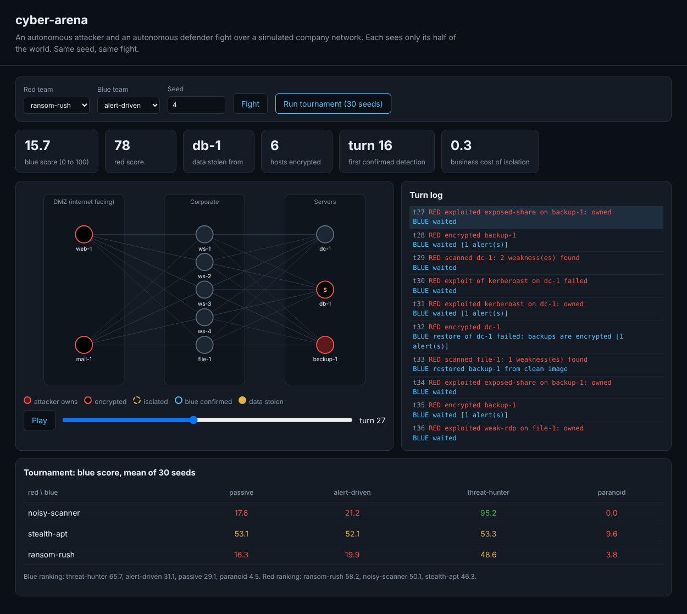

# cyber-arena

[](https://github.com/jvch0512/cyber-arena/actions/workflows/ci.yml)

An autonomous attacker and an autonomous defender fight over a simulated company network, turn by turn. Each side only sees its half of the world. You can watch any fight, replay it on a slider, run a tournament, and plug in your own agents. Same seed, same fight, so results are reproducible and arguable.

It is a small cyber range for one question that matters to anyone buying or building defences: **what actually beats what?** Detection alone, patching alone, or isolating everything?



## Run

```bash
npm install
npm test                                 # 18 tests
npm start                                # UI on http://127.0.0.1:8787, localhost only
node dist/src/cli.js tournament          # 3 red x 4 blue x 30 seeds
node dist/src/cli.js match --red ransom-rush --blue alert-driven --seed 4 --log
```

## The world

Ten hosts in three zones: DMZ (web, mail), corporate (four workstations, a file server) and servers (domain controller, database, backup). The estate is generated from the seed: every host gets one or two weaknesses and its own logging quality. 60 turns, one action each.

**Red** can scan, phish, exploit a known weakness, steal credentials, move laterally, exfiltrate (three staged turns, so there is a window to stop it), encrypt, and tamper with logs to become harder to see. **Blue** can investigate a host, isolate it, restore it from a clean image, patch a weakness, reset credentials and harden a zone.

**Partial information.** Blue sees alerts, not the truth. Loud actions on well-logged hosts usually alert, quiet ones rarely do, and one turn in four there is a false alarm. Red sees only what it has scanned. Tests check that neither side can read the other's state.

**Rules with consequences.** Restoring an encrypted host only works while the backups are intact, so ransomware that hits the backup server first turns every recovery into a failure. Restoring without patching just invites the attacker back. Isolating a healthy host costs business value every turn, which is why paranoia is not free.

**Scoring.** Blue starts at 100 and loses 40 for stolen database data (15 for the file server), 4 per encrypted host, 2 per compromised host and the business cost of isolation. Red scores the mirror image. Every number is in `src/engine.ts`.

## Built-in agents

| Red | Behaviour |
|---|---|
| noisy-scanner | scans everything, exploits anything, encrypts as it goes |
| stealth-apt | phishes one workstation, steals credentials, walks to the domain controller and the database, exfiltrates, wipes its tracks |
| ransom-rush | gets in, spreads, takes the backup server first, then encrypts |

| Blue | Behaviour |
|---|---|
| passive | only reacts once something is encrypted |
| alert-driven | investigates strong alerts, isolates and restores confirmed hosts, resets credentials |
| threat-hunter | alert-driven, plus hardens the server zone, patches crown jewels and sweeps high-value hosts when idle |
| paranoid | isolates any host that alerts |

## Result: 30 seeds

```
blue score (higher is better), mean of 30 seeds

                       passive  alert-driven threat-hunter      paranoid
noisy-scanner             17.8          21.2          95.2           0.0
stealth-apt               53.1          52.1          53.3           9.6
ransom-rush               16.3          19.9          48.6           3.8

blue leaderboard: threat-hunter 65.7 > alert-driven 31.1 > passive 29.1 > paranoid 4.5
red leaderboard:  ransom-rush 58.2 > noisy-scanner 50.1 > stealth-apt 46.3
```

What it shows:

- **Prevention beats reaction against noisy attackers.** The hunter patches the database and domain controller before the attacker arrives and scores 95 against noisy-scanner. Detection-only blue (alert-driven) scores 21: it restores hosts, the attacker walks back in through the same hole.
- **Paranoia is a failure mode.** With a 25% false alarm rate and a cost for every isolated host, isolating on every alert loses to every attacker, including the quiet one it was meant to catch.
- **Nobody beats stealth-apt.** It uses stolen credentials, not exploits, so patching does not slow it, and it only generates a few quiet alerts. Every blue agent except paranoid scores about 52 to 53 against it. This is the open problem, and it is where your agent can earn its place.

## Write your own agent

Agents are plain objects. They get an observation and a random function and return one action. An agent that throws or returns a nonsense action just wastes the turn.

```ts
import { playMatch } from "./engine.js";
import { stealthApt } from "./agents.js";
import type { BlueAgent } from "./types.js";

const credentialWatch: BlueAgent = {
  name: "credential-watch",
  act(obs) {
    // try: reset credentials whenever a 'credential' or 'lateral' alert fires,
    // and investigate the domain controller as soon as one appears
    const alert = obs.alerts.find((a) => a.signal === "credential" || a.signal === "lateral");
    return alert ? { kind: "reset" } : { kind: "wait" };
  },
};

console.log(playMatch(1, stealthApt, credentialWatch).score);
```

Add it to `BLUE` in `src/agents.ts` and it appears in the UI and the tournament. The challenge: score above 70 against stealth-apt averaged over 30 seeds without dropping below the hunter on the other two attackers.

## Safety notes

Agents run in-process, so only load agents you trust. The UI serves from 127.0.0.1 with a strict CSP (no inline scripts or styles) and uses no network. The simulation touches nothing outside memory.

## Limits

This is a model, not a faithful network. The probabilities are judgement values chosen to make trade-offs visible, not measured rates, and the built-in agents are hand-written heuristics, not learned policies. Treat the leaderboard as a way to compare strategies inside this world, not as evidence about real products.

MIT licensed.
